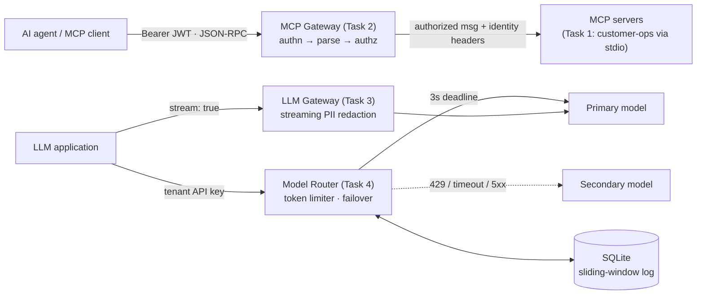

# QuilrAI: Solution Architect Assessment

Four runnable components covering the MCP and LLM gateway surface, written in **TypeScript on Node.js 22.13+** with a test suite for each (**76 tests**, `npm test`).

| # | Component | Entry point | Key ideas |
|---|-----------|-------------|-----------|
| 1 | MCP server (stdio) with strict validation | [`src/task1-mcp-server`](src/task1-mcp-server) | Low-level SDK `Server` so validation maps to JSON-RPC `-32602`; Zod `strictObject`; stdout reserved for JSON-RPC |
| 2 | MCP security gateway (tool filtering and auth) | [`src/task2-mcp-gateway`](src/task2-mcp-gateway) | JWT role extraction; method-level authz; `-32001` returned without touching downstream; anti-smuggling re-serialization; no token passthrough |
| 3 | LLM gateway streaming PII guardrail | [`src/task3-llm-gateway`](src/task3-llm-gateway) | Minimal-holdback streaming redactor (provably equal to one-shot redaction); O(1) memory; about +1 token TTFT; backpressure and abort propagation |
| 4 | Rate limiting and model fallback router | [`src/task4-model-router`](src/task4-model-router) | Token-aware sliding-window log in on-disk SQLite with `BEGIN IMMEDIATE`; 3000 ms deadline; failover on 429/timeout/5xx; sanitized errors; circuit breaker |



In production, Tasks 3 and 4 would be stages of one LLM gateway pipeline (auth, then rate limit, then route and fail over, then the response guardrail). They are kept separate here so each can be run and graded alone.

---

## Quick start

```bash
npm install
npm test          # 76 tests: unit, property and integration
npm run typecheck
```

No Python, Docker or native modules are needed. SQLite is Node's built-in `node:sqlite`.

---

## Task 1: Custom MCP server with strict validation and stdio transport

```bash
npm run task1              # speaks JSON-RPC on stdin/stdout, logs on stderr
npm run task1:inspect      # open it in the official MCP Inspector
```

Claude Desktop / any MCP client config:
```json
{ "mcpServers": { "customer-ops": { "command": "npx", "args": ["tsx", "<abs-path>/src/task1-mcp-server/server.ts"] } } }
```

**Tools**

| Tool | Input | Rules |
|---|---|---|
| `get_customer_record` | `customer_id` | `^CUST-\d{5}$`, anchored and case-sensitive, so `cust-12345`, ` CUST-12345` and `CUST-123456` are all rejected |
| `trigger_refund` | `customer_id`, `amount`, `reason` | `amount`: a JSON number (no `"10"` coercion), > 0, ≤ 10,000, ≤ 2 decimals. `reason`: trimmed length 10–1000. Unknown keys are rejected |

**Design decisions**

- **Why the low-level `Server` and not `McpServer`?** In SDK 1.x, `McpServer` catches schema failures and returns a *successful* result with `isError: true`. The brief asks for standard JSON-RPC error codes, so the server validates with Zod itself and throws `McpError(InvalidParams)`. The tools' JSON Schemas are generated from the same Zod schemas (`z.toJSONSchema`), so the advertised contract and the enforced contract cannot drift apart.
- **Protocol errors vs tool errors**, as the MCP spec separates them:

  | Situation | Response |
  |---|---|
  | Invalid or missing arguments, unknown tool | JSON-RPC error **-32602**, with `data.issues[] = {field, message, code}` listing *all* problems at once |
  | Unknown JSON-RPC method | **-32601** (handled by the SDK) |
  | Valid input that breaks a business rule (not found, over refundable balance, suspended account) | `result.isError: true`, so the LLM can see the reason and recover |
  | Unexpected exception | **-32603** with a generic message; the stack trace goes to stderr only |

- **STDIO isolation**, in three layers: (1) every log goes through a stderr-only JSON logger; (2) `console.log/info/debug/dir/table` are redirected to stderr at startup, so a stray print from a dependency cannot corrupt the stream; (3) tests check that *every* stdout line is a JSON-RPC 2.0 message, and a static test fails the build if the server source references `console.log` or `process.stdout`.
- Money is handled in integer cents. `trigger_refund` carries `destructiveHint: true` so clients can require human confirmation.
- On stdin EOF the process does not call `process.exit()` (pipe writes are asynchronous on Windows); it exits naturally once stdout drains.

---

## Task 2: MCP security gateway proxy

```bash
npm run task2:mock                         # downstream mock MCP server on :9090
npm run task2                              # gateway on :8080 → http://127.0.0.1:9090/mcp
VIEWER=$(npm run -s task2:token -- viewer bob)
ADMIN=$(npm run -s task2:token -- admin alice)

# forwarded transparently
curl -s localhost:8080/mcp -H "authorization: Bearer $VIEWER" -H 'content-type: application/json' \
  -d '{"jsonrpc":"2.0","id":1,"method":"tools/list"}'

# blocked at the gateway: {"jsonrpc":"2.0","id":2,"error":{"code":-32001,"message":"Unauthorized Tool Call"}}
curl -s localhost:8080/mcp -H "authorization: Bearer $VIEWER" -H 'content-type: application/json' \
  -d '{"jsonrpc":"2.0","id":2,"method":"tools/call","params":{"name":"admin_reset_key","arguments":{}}}'
```

Environment: `GATEWAY_JWT_SECRET`, `GATEWAY_AUDIENCE` (default `mcp-gateway`), `UPSTREAM_MCP_URL`, `PORT`.

**Request pipeline:** authenticate → parse and validate the envelope → authorize → forward (streamed).

| Check | Result |
|---|---|
| Missing, malformed, forged or expired JWT, wrong `aud`, `alg: none`, unknown role | HTTP 401 + `WWW-Authenticate: Bearer`, JSON-RPC `-32000` |
| Body is not JSON | `-32700` Parse error |
| JSON-RPC batch (array) | `-32600`. MCP 2025-06-18 removed batching, and rejecting it closes the "hide an admin call in a batch" bypass |
| `tools/call` without a string `params.name` | `-32602` |
| `tools/call` to `admin_*` by a non-admin | `-32001 Unauthorized Tool Call`, **downstream never called** (asserted in tests) |
| Downstream unreachable | HTTP 502, `-32002` |

**Security details worth calling out**

- **Parser-differential / duplicate-key smuggling.** `{"params":{"name":"admin_reset_key","name":"get_customer_record"}}` could be authorized as one tool by the gateway and executed as the other by a downstream parser that keeps the *first* duplicate. The gateway therefore forwards the **re-serialized message it authorized**, never the raw bytes. A test covers both orderings.
- **No token passthrough** (an MCP security best practice). The client's `Authorization` header is stripped. Downstream receives gateway-asserted `x-mcp-user-sub` / `x-mcp-user-role` / `x-request-id`, and any client-supplied copies of these are removed so they cannot be spoofed.
- **Name normalization.** `admin_` matching uses NFKC + lower-case, so `ADMIN_x` and full-width look-alikes are denied. Normalization can only make the policy stricter.
- The JWT verifier allows HS256 only, compares signatures in constant time, and requires `exp`.
- Responses are **piped**, so Streamable-HTTP SSE responses and `GET`/`DELETE` session requests work. Waiting for upstream headers is bounded; once streaming starts there is no timeout. A client disconnect tears down the upstream request.
- Denials return **HTTP 200 + JSON-RPC error** so MCP clients report them as tool errors rather than transport failures. Every allow/deny decision is logged as structured JSON with `sub`, `role`, `method`, `tool` and `requestId` (SIEM-ready).

*Extensions I'd add next:* filter `admin_*` tools out of `tools/list` for viewers (least-privilege discovery), JWKS/RS256 with key rotation, per-tool policies from configuration (OPA/Cedar), argument-level policies, and rate limiting per principal.

---

## Task 3: LLM gateway streaming guardrail (PII redaction)

```bash
npm run task3:mock     # OpenAI-compatible mock on :9091 that streams PII in 1–7 char chunks
npm run task3          # gateway on :8081
curl -N localhost:8081/v1/chat/completions -H 'content-type: application/json' \
  -d '{"model":"m","stream":true,"messages":[{"role":"user","content":"who is the customer?"}]}'
```

To point it at a real provider: `UPSTREAM_BASE_URL=https://api.openai.com/v1 UPSTREAM_API_KEY=sk-... npm run task3`. The provider key stays on the gateway; clients never see it.

**The core problem:** tokens split PII anywhere (`"jane.d" | "oe@exam" | "ple.com"`). Redacting each chunk on its own misses these matches. Buffering the whole response ruins TTFT and memory use.

**Solution: a minimal-holdback streaming redactor** ([`redactor.ts`](src/task3-llm-gateway/redactor.ts))

1. Every detected pattern (email, SSN, card number) is built only from *token characters* `[A-Za-z0-9._%+-@]`, plus single spaces between digit groups for cards like `4111 1111 1111 1111`.
2. After each chunk the redactor emits everything up to the start of the trailing run that could still grow into a match, and holds back only that run. In practice this is the last partial word.
3. A cut always lands right after a non-token character, so **no match can straddle a cut** and `\b` anchors behave as they would on the whole string. Streaming output is therefore **identical to one-shot redaction**. A property test checks this over more than 2,000 random chunkings, including single characters.
4. The holdback is capped at 512 characters (above the 254-char email limit), so **memory per stream is O(1)** whatever the response length, and the total work is linear.

| Pattern | Detection | False-positive control |
|---|---|---|
| Email | RFC-ish local@domain.tld | requires a TLD |
| SSN | `ddd-dd-dddd` | excludes SSA-invalid ranges (000, 666, 9xx, 00, 0000) |
| Card | 13–19 digits, optional single space/dash groups | **Luhn checksum**, so order numbers survive |

**Gateway mechanics** ([`gateway.ts`](src/task3-llm-gateway/gateway.ts))

- Headers are flushed immediately, `TCP_NODELAY` is on, and `X-Accel-Buffering: no` is set. Each upstream delta is redacted and written as it arrives. TTFT increases by roughly one token, which the e2e test asserts.
- A streaming `TextDecoder` keeps multi-byte UTF-8 (CJK, emoji) intact when it is split across TCP chunks (tested).
- An incremental SSE parser handles LF/CRLF and events split at any byte.
- **Backpressure:** a slow client causes `await drain`, which pauses the `for await` over the upstream body, so memory stays bounded end to end.
- **Abort propagation:** a client disconnect aborts the upstream fetch, which stops token spend (tested).
- Separate redactor state per `choice.index` and per **tool-call argument stream**, because PII also leaks through function arguments. Held-back text is flushed before `finish_reason` and `[DONE]`.
- Fails closed: unparseable upstream events are dropped, not forwarded. Provider error bodies are never echoed.

*Production notes:* add NER-based detection (e.g. Presidio) as an asynchronous second tier for names and addresses, configurable per tenant (redact / mask / block), and prompt-side (request) redaction.

---

## Task 4: Rate limiting and model fallback router

```bash
npm run task4:mock                       # primary :9092, secondary :9093
npm run task4                            # router on :8082, SQLite file ./rate-limits.db
curl -s localhost:8082/v1/chat/completions -H 'authorization: Bearer tenant-a-key' \
  -H 'content-type: application/json' -d '{"messages":[{"role":"user","content":"hi"}],"max_tokens":50}' -i

# make the primary misbehave and watch x-gateway-route switch to "fallback"
curl -s localhost:9092/__mode -d '{"mode":"429"}'     # or "slow" (5 s > 3 s deadline), "500", "400", "ok"
```

Environment: `TENANT_API_KEYS`, `TOKENS_PER_MINUTE` (50000), `RATE_LIMIT_DB`, `PRIMARY_BASE_URL`, `PRIMARY_API_KEY`, `PRIMARY_MODEL`, `PRIMARY_TIMEOUT_MS` (3000), `SECONDARY_*`.

**Token-aware sliding-window limiter** ([`rate-limiter.ts`](src/task4-model-router/rate-limiter.ts))

- A *sliding log*: one row per admitted request `(tenant_hash, ts_ms, tokens)`. Usage = `SUM(tokens)` over `(now-60s, now]`. This is exact, with no 2x burst at window edges as with fixed windows.
- **Reserve → commit → release.** The router reserves *estimated prompt tokens + `max_tokens`*. On success it replaces the estimate with the provider's actual `usage.total_tokens`, freeing over-reservation immediately. If all providers fail, the reservation is deleted, so tenants are not charged for failed calls.
- **Atomicity:** the check and the insert run in one `BEGIN IMMEDIATE` transaction. SQLite's write lock serialises concurrent reservations **even across several gateway processes sharing the DB file** (tested with two instances). WAL mode plus `busy_timeout` handle contention.
- **Eviction:** expired rows for the tenant are deleted on every check (indexed by `(tenant, ts_ms)`), plus a global `sweep()` every 30 s.
- `Retry-After` is computed precisely: the time until enough of the oldest rows leave the window to fit the request. Requests larger than the entire budget get `413`, not a misleading "retry later".
- API keys are stored only as SHA-256 hashes, and key lookup is constant-time.

**Failover and timeout races** ([`router.ts`](src/task4-model-router/router.ts))

| Primary outcome | Action |
|---|---|
| 2xx | serve, commit actual usage |
| **429**, **timeout (3000 ms)**, 5xx, network error, malformed JSON | fail over to secondary |
| other 4xx (400/404/422) | **no failover**: the request itself is bad, and retrying doubles cost. Returns a sanitized 400 |
| 401/403 | our provider credentials are wrong, so a sanitized 502 is returned (never blame the client) |
| client disconnected | abort the in-flight attempt; **no** failover |

- Each attempt has its own `AbortController`. The deadline covers headers **and** body, so a provider that sends headers at 2.9 s and then stalls still times out. Aborting tears down the socket, so a late primary response can never resolve the request after failover has started. Timers and listeners are always cleaned up in `finally`.
- A **circuit breaker** (3 consecutive failures, then open for 30 s, then half-open) stops every request paying the full 3 s timeout during a primary outage.

**Standardized, sanitized errors** ([`errors.ts`](src/task4-model-router/errors.ts)). Clients only ever see:

```json
{ "error": { "type": "api_error", "code": "upstream_unavailable", "message": "All model providers are currently unavailable", "request_id": "…" } }
```

Codes: `invalid_request` 400, `unauthorized` 401, `request_too_large` 413, `rate_limited` 429 (+`Retry-After`, `x-ratelimit-*`), `upstream_unavailable` 502/503, `upstream_timeout` 504, `internal_error` 500. Upstream bodies, stack traces, IPs and provider names are logged server-side under the `request_id` and never returned (tests assert that `ECONNREFUSED`, internal IPs and provider names do not appear).

*Scaling note:* SQLite is right for a single node or a few processes on one host. A horizontally scaled fleet would move the same algorithm to Redis (a sorted set per tenant plus a Lua script for an atomic check-and-insert), or use a token bucket when an approximate limit is acceptable.

---

## Repository layout

```
src/
  shared/              stderr JSON logger, HTTP helpers (body limits, backpressure)
  task1-mcp-server/    schemas.ts (Zod) · store.ts (mock CRM) · server.ts (stdio MCP server)
  task2-mcp-gateway/   gateway.ts · policy.ts (pure authz) · jwt.ts · mock-mcp-server.ts · mint-token.ts
  task3-llm-gateway/   gateway.ts · redactor.ts · sse.ts · mock-llm.ts
  task4-model-router/  server.ts · router.ts · rate-limiter.ts (SQLite) · errors.ts · mock-providers.ts
test/                  one suite per task (node:test)
```
